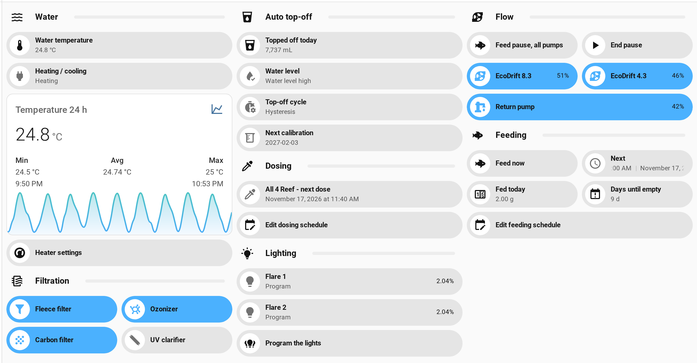
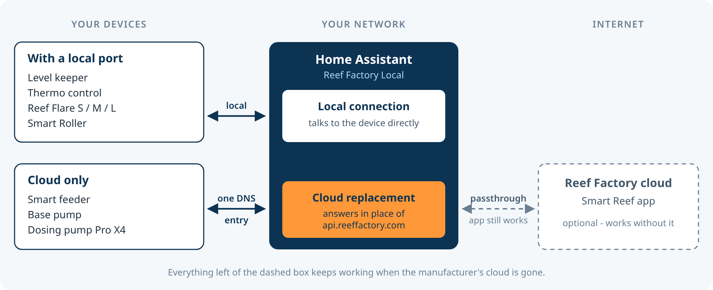
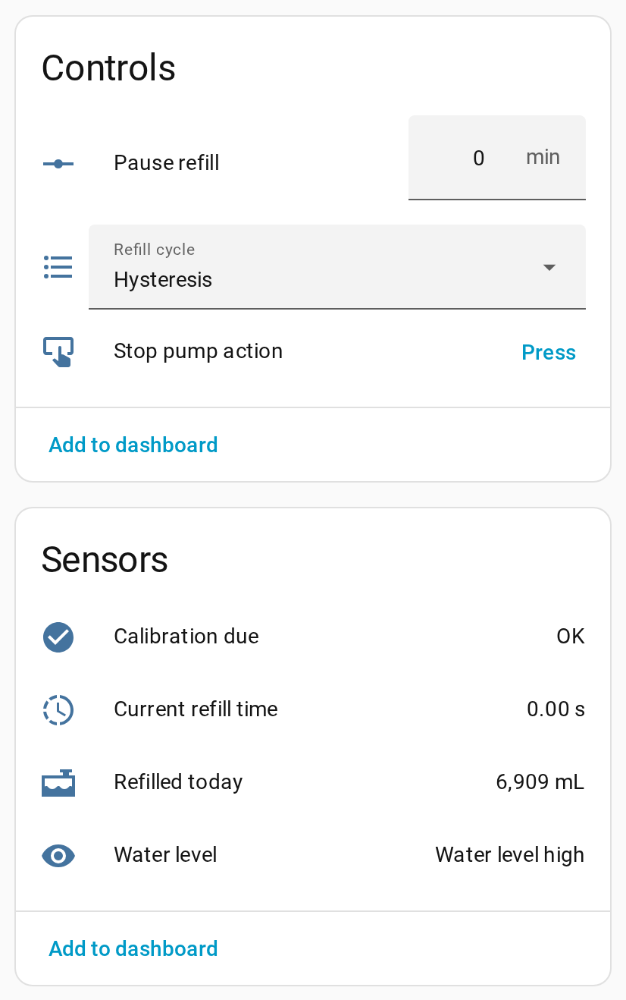
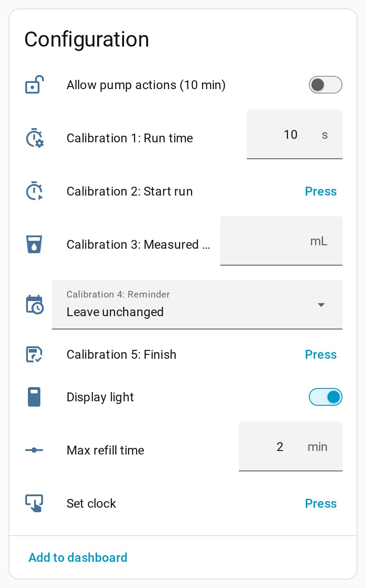
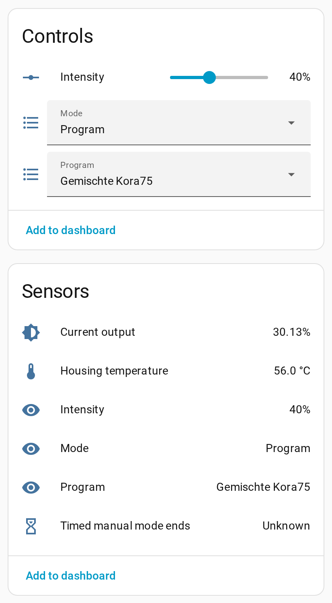
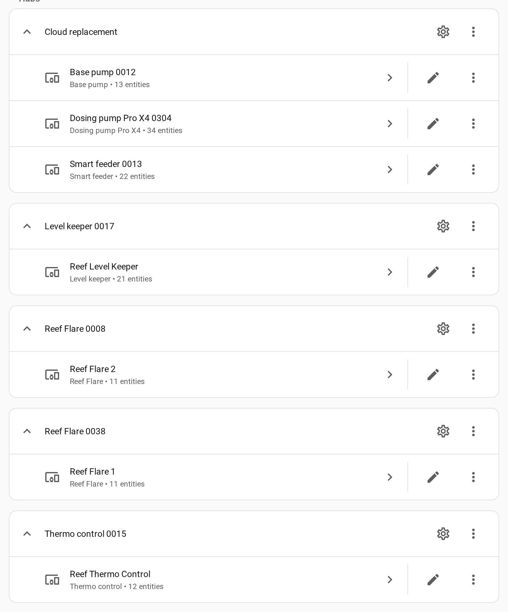

<h1> Reef Factory Local (unofficial)</h1>

**Local control of Reef Factory aquarium devices in Home Assistant - no cloud.**

> **Unofficial community project. Not affiliated with, endorsed by or supported by Reef Factory.**
> "Reef Factory", "Smart Reef", "Level keeper", "Thermo control", "Reef Flare", "Smart feeder",
> "Base pump", "Dosing pump Pro X4" and "Smart Roller" are the manufacturer's product names and are used only to
> describe which devices this integration works with.

Reef Factory went insolvent in 2025; the cloud keeps running for now but may disappear.
Level keeper, Thermo control, Reef Flare and Smart Roller speak a local WebSocket protocol, which this
integration uses. Smart feeder, Base pump and Dosing pump Pro X4 only talk to the cloud - for them Home
Assistant takes the cloud's place (*Cloud replacement*).

  

My own aquarium dashboard, built on the entities of this integration (the EcoDrift pumps come from <a href="https://github.com/patrickk88/aquamedic-local">AquaMedic Local</a>).

  

  
  
  

Level keeper, its guided calibration and a Reef Flare S in Home Assistant.

**Contents:** [Supported devices](#supported-devices) · [Installation](#installation) ·
[Safety](#safety) · [Cloud replacement](#cloud-replacement) · [Questions](#questions) ·
[When something does not work](#when-something-does-not-work) · [Documentation](#documentation)

## Supported devices

| Device | Serial | Connection | What you get | Tested firmware |
|---|---|---|---|---|
| Level keeper | `RFLK…` | local | refill amount and state, refill cycle, safety limit, pause, calibration | 1.0.0 |
| Thermo control | `RFTC…` | local | temperature, heating / cooling, thresholds, beeper | 1.0.0 |
| Reef Flare S / M / L | `RFRFS…` `RFRFM…` `RFRFL…` | local | mode, programs, intensity, timed manual mode, acclimation | 1.0.0 (S) |
| Smart Roller | `RFSR…` | local | fleece left, automatic advance, advance now, new roll | 1.1.1 |
| Smart feeder | `RFSF…` | cloud replacement | feed now, schedule, interval, container | 1.1.6 |
| Base pump | `RFBP…` | cloud replacement | speed, feed pause, display | 1.4.1 |
| Dosing pump Pro X4 | `RFDQ…` | cloud replacement | doses and container per channel, dose now, schedule | 1.2.3 |

*local* - the integration talks to the device directly, by its IP address.
*cloud replacement* - the device has no local port; Home Assistant answers in place of the cloud
(see [Cloud replacement](#cloud-replacement)).

**Everything each device offers** - click a device to open it:

<b>Level keeper</b> (<code>RFLK…</code>)

- **Read:** refilled today, state (ok / refilling / water high / water low / paused / calibrating / filling
  hose / manual refill), current refill time, calibration date, calibration due, cloud connected.
- **Control:** refill cycle, max refill time (safety limit), pause refill, display light, set clock.
- **Opt-in pump actions:** manual refill (max 1000 mL), calibration (as actions or guided with buttons),
  fill hose, plus stop. See
  [Pump actions and guided calibration](https://github.com/patrickk88/reef-factory-local/blob/main/docs/pump-actions.md).
- **Event** for automations: *Refill*.
- Tested firmware: 1.0.0.

<b>Thermo control</b> (<code>RFTC…</code>)

- **Read:** temperature, heating / cooling, all four thresholds, beeper, display light, cloud connected.
- **Control:** thresholds (alarm below / target range low / target range high / alarm above, always sent
  together, order checked), beeper, display light (°C units only so far).
- Tested firmware: 1.0.0.

<b>Reef Flare S / M / L</b> (<code>RFRFS…</code>, <code>RFRFM…</code>, <code>RFRFL…</code>)

- **Read:** housing temperature, mode, active program with its light schedule (points per channel), list of
  programs, intensity, current output (computed), acclimation, manual presets, end of the timed manual mode,
  cloud connected.
- **Control:** mode (program / manual / off), active program, intensity (program mode).
- **Actions:** write the active program, create or delete a program, timed manual mode (also with a stored
  manual preset), save or delete a manual preset, import / export of the app's files, acclimation start /
  stop (one or more lights). See
  [Reef Flare programs and actions](https://github.com/patrickk88/reef-factory-local/blob/main/docs/reef-flare.md).
- Tested firmware: 1.0.0, on two Reef Flare S. The M and L models hold two and three of the same light
  modules and use the same web interface, so the integration treats them the same way.

<b>Smart Roller</b> (<code>RFSR…</code>)

- **Read:** state (automatic advance on / off, jammed), fleece left (m and %), used today, daily average,
  roll length, advance length, start delay, cloud connected.
- **Controls:** switch *Automatic advance*, buttons *Advance now* (uses the advance length), *Clear jam*
  (only available while the roller reports jammed), *New roll inserted* and *Used roll inserted*.
- **Configuration:** selects *Advance length* (3-15 cm) and *Start delay*, number *Used roll diameter*.
- **Changing the roll**, as in the app: for a new roll press *New roll inserted*. For a used (partial) roll
  set *Used roll diameter* to its outer diameter (45-140 mm) and press *Used roll inserted* - the roller
  works out the length left. The diameter is only kept in Home Assistant; nothing is sent until the button
  is pressed. Both buttons reset the roll counter.
- **Actions** `smart_roller_advance` (any offered length) and `smart_roller_new_roll` (optional
  `used_diameter_mm`) do the same from automations.
- Tested firmware: 1.1.1 - not on my bench, tested by Steven Downer on his roller (`RFSRL…`);
  layout and commands from his
  [ha-reef-factory-smartroller](https://github.com/downerhouse/ha-reef-factory-smartroller).

The Smart Roller is recognised by its serial number (`RFSR…`; seen so far: `RFSRL…` with firmware 1.1.1).
Should a roller carry another prefix, it is still found: when a device answers with an unknown serial, the
setup sends it the Smart Roller subscription and waits a few seconds for its report (nothing is written).
If you own one with another firmware or serial prefix: an issue with the *Download diagnostics* file (it
contains the raw report, `report_hex`) and the firmware shown on the device page helps.

<b>Smart feeder</b> (<code>RFSF…</code>) - via the cloud replacement

- **Read:** next / last feeding, days until empty, fed today, schedule, container empty, real-cloud status,
  Wi-Fi signal.
- **Control:** feed now, feeding mode (schedule / interval), schedule (action), interval, container values,
  dose per rotation, LED backlight, feeding button, refill reminder.
- **Event** for automations: *Feeding*. Binary sensor *Food running low*.
- Tested firmware: 1.1.6.

<b>Base pump</b> (<code>RFBP…</code>) - via the cloud replacement

- **Read:** mode, feed pause remaining, alert, speed, feed-mode duration and speed, display, backlight,
  real-cloud status, Wi-Fi signal.
- **Control:** feed pause (switch), speed, feed-mode duration and speed, display, backlight (settings always
  sent together, like the app does).
- Tested firmware: 1.4.1.

<b>Dosing pump Pro X4</b> (<code>RFDQ…</code>) - via the cloud replacement

- **Read:** per channel: next dose, last dose, dosed today, container, days until empty, calibration date;
  schedule, history and calibration details as attributes; real-cloud status, Wi-Fi signal.
- **Opt-in pump actions** (cloud entry options): dose now, replace a channel's schedule (actions). See
  [Pump actions](https://github.com/patrickk88/reef-factory-local/blob/main/docs/pump-actions.md).
- Rename a channel (action, not a pump action).
- **Event** for automations: *Dose*. Binary sensor *Channel n container low* per channel.
- Tested firmware: 1.2.3.

**Another Reef Factory device?** It can be added too, read only, so that its diagnostics file shows what
it sends - see [Contributing](https://github.com/patrickk88/reef-factory-local/blob/main/CONTRIBUTING.md).

The interface is available in English, German, Dutch, French, Spanish, Italian and Polish.

## Installation

Needs Home Assistant 2025.3 or newer.

**1. Find *Reef Factory Local* in HACS** (from Home Assistant 2026.11 on it is called *Marketplace*),
download it and restart Home Assistant:

**2. Add the integration** - once per device with a local port, by its IP address:

**3. For Smart feeder, Base pump and Dosing pump Pro X4:** add the integration once more, choose
*Cloud replacement* and set one DNS entry in your network - see [Cloud replacement](#cloud-replacement).

Without the buttons, or without HACS / Marketplace

The first button opens this integration in HACS - or in the Marketplace, as HACS is called from Home
Assistant 2026.11 on - in your own Home Assistant. Without the button: open HACS or the Marketplace and
search for *Reef Factory Local* (it is in the default list). Or copy
`custom_components/reef_factory_local` into your Home Assistant `config/custom_components/` and restart.

Then *Settings -> Devices & services -> Add integration -> Reef Factory Local (unofficial)*.

More than one device, and what an entry is

Add the integration once per device with a local port (Level keeper, Thermo control, Reef Flare, Smart
Roller) by its IP address. Several devices of the same kind are fine - for example two Level keepers on two
tanks or two Reef Flares over one tank; each one gets its own entry and its own entities. The devices
without a local port (Smart feeder, Base pump, Dosing pump Pro X4) all come in through one *Cloud
replacement* entry.

Good to know before you start:

- **Give every device a fixed address.** Setup needs only the IP address; serial number and type are read
  from the device. The devices always use DHCP, so set a DHCP reservation ("always assign the same IP") in
  your router.
- **Keep local connections few.** Close the app and the devices' own web pages when you are done - see
  [Stuck web server](https://github.com/patrickk88/reef-factory-local/blob/main/docs/troubleshooting.md#stuck-web-server-http-429).
- **Recommended for all devices:** let their cloud connection run through the
  [cloud replacement](#cloud-replacement), also for the devices with a local port.

## Safety

### Use at your own risk

This software is provided "as is", without warranty of any kind (see the MIT license). It talks to
devices that run pumps, heaters, lights and dosing pumps. A bug, a wrong automation or a lost network
connection can flood a room, overdose a tank or cook or freeze its inhabitants. **You alone are
responsible for your tank.** Keep the devices' own safety limits, watch the tank after installing or
updating, and do not let automations dose or refill without a limit you have checked. The authors are
not liable for any damage to equipment, livestock or property.

Using it may void your warranty; check your contract with the manufacturer or dealer if that matters to
you. How the protocol was found is described in the
[protocol notes](https://github.com/patrickk88/reef-factory-local/blob/main/docs/protocol.md).

### Only confirmed writes are sent

Every write this integration offers was checked on a real device: the change was sent from Home
Assistant, the device reported the new value (for pump runs: the new state and its end), and the old
value was put back. Anything that could not be confirmed this way is not offered - it stays readable
only until someone confirms it on hardware. **Nothing is filled in:** where a device takes several
settings in one frame, the others are repeated exactly as the device last reported them - no zero or
default is ever sent in their place.

**[Confirmed writes per device and firmware, with dates](https://github.com/patrickk88/reef-factory-local/blob/main/docs/confirmed-writes.md)**

### Pump actions are off by default

Everything that runs the refill pump of a Level keeper or puts additives into the tank with the Dosing
pump Pro X4 is only available as an action, and only after enabling *Allow pump actions* - for good in
the entry's options, or for ten minutes with a switch. Stopping the Level keeper always works. Factory
reset is deliberately not offered.

**[Pump actions and guided calibration](https://github.com/patrickk88/reef-factory-local/blob/main/docs/pump-actions.md)**

## Cloud replacement

The Smart feeder, the Base pump and the Dosing pump Pro X4 have no local interface at all: they only talk
to `api.reeffactory.com`. They do not check the server certificate, so Home Assistant can take the cloud's
place. Add the integration a second time and choose **Cloud replacement** - no IP, no serial number; every
device that connects shows up by itself with all its entities.

- **Passthrough** (default): everything is forwarded to the real cloud and read along. The official app
  keeps working, and when the real cloud cannot be reached the device is served locally instead.
- **Local:** Home Assistant answers alone; the app does not see the device any more.

The one thing you have to do yourself is a **DNS entry**: inside your network `api.reeffactory.com` must
point to the Home Assistant host. Level keeper, Thermo control and Reef Flare can use the same way for
their cloud connection; then the integration can restart them by itself when their web server is stuck.

**[Cloud replacement: DNS, ports, security, options](https://github.com/patrickk88/reef-factory-local/blob/main/docs/cloud-replacement.md)**

## Questions

<b>Does the official Smart Reef app keep working?</b>

Yes. For the devices with a local port Home Assistant is just one more client. With the cloud
replacement in *passthrough* mode (the default) everything is forwarded to the real cloud, so the app
works as before, at home and on the road. Only in *local* mode the app no longer sees the devices.

<b>Do I still need the cloud or a Smart Reef account?</b>

Not for Level keeper, Thermo control, Reef Flare and Smart Roller - they are read and controlled in your
own network. Smart feeder, Base pump and Dosing pump Pro X4 cannot talk locally; for them the cloud
replacement plays the cloud's part, and when the real cloud cannot be reached they are served by Home
Assistant alone.

<b>What happens when Home Assistant is down?</b>

The devices carry on by themselves: refilling, heating, light programs, feeding and dosing schedules live
in the devices. What is missing is the control from Home Assistant and your automations. If you use the
cloud replacement, the cloud-only devices and the app at home also cannot reach the cloud until Home
Assistant is back - the devices reconnect by themselves.

<b>Can I break something with it?</b>

The integration only sends what was confirmed on a real device, pump actions have to be switched on
first, and there is no factory reset and no firmware change. But it does control pumps, a heater and
lights - a wrong automation can harm your tank. See [Safety](#safety).

<b>My Reef Factory device is not on the list</b>

It can be added read only, so that its diagnostics file shows what it sends - that is what is needed to
support it. See [Contributing](https://github.com/patrickk88/reef-factory-local/blob/main/CONTRIBUTING.md).

Something else? [Open an issue](https://github.com/patrickk88/reef-factory-local/issues).

## When something does not work

| What you see | Where to look |
|---|---|
| Entities unavailable, repair message about a stuck device | [Stuck web server (HTTP 429)](https://github.com/patrickk88/reef-factory-local/blob/main/docs/troubleshooting.md#stuck-web-server-http-429) |
| The device opened its own hotspot | [Device lost its Wi-Fi?](https://github.com/patrickk88/reef-factory-local/blob/main/docs/troubleshooting.md#device-lost-its-wi-fi) |
| The official app shows the device offline | [Cloud and Smart Reef account](https://github.com/patrickk88/reef-factory-local/blob/main/docs/troubleshooting.md#cloud-and-smart-reef-account) |
| The device has a new IP address | [New address](https://github.com/patrickk88/reef-factory-local/blob/main/docs/troubleshooting.md#new-ip-address) |
| Something behaves oddly | [Known quirks](https://github.com/patrickk88/reef-factory-local/blob/main/docs/troubleshooting.md#known-quirks) |
| You want to report a problem | [Open an issue](https://github.com/patrickk88/reef-factory-local/issues/new/choose) and attach the [diagnostics file](https://github.com/patrickk88/reef-factory-local/blob/main/docs/troubleshooting.md#diagnostics) |

## Documentation

| Page | What is in it |
|---|---|
| [Confirmed writes](https://github.com/patrickk88/reef-factory-local/blob/main/docs/confirmed-writes.md) | every write, on which device and firmware it was confirmed, and what is not offered |
| [Pump actions and guided calibration](https://github.com/patrickk88/reef-factory-local/blob/main/docs/pump-actions.md) | the opt-in, the 10-minute switch, calibrating a Level keeper step by step |
| [Reef Flare programs and actions](https://github.com/patrickk88/reef-factory-local/blob/main/docs/reef-flare.md) | programs, timed manual mode, manual presets, import / export, with examples |
| [Cloud replacement](https://github.com/patrickk88/reef-factory-local/blob/main/docs/cloud-replacement.md) | modes, DNS, ports, security, options |
| [Automations](https://github.com/patrickk88/reef-factory-local/blob/main/docs/automations.md) | events, timestamps, container warnings |
| [Troubleshooting](https://github.com/patrickk88/reef-factory-local/blob/main/docs/troubleshooting.md) | stuck web server, lost Wi-Fi, network notes, known quirks, diagnostics |
| [Protocol notes](https://github.com/patrickk88/reef-factory-local/blob/main/docs/protocol.md) | frames, cloud channel, how the protocol was found |
| [Changelog](https://github.com/patrickk88/reef-factory-local/blob/main/CHANGELOG.md) · [Contributing](https://github.com/patrickk88/reef-factory-local/blob/main/CONTRIBUTING.md) | versions, and how to help with a device that is not supported yet |

## Credits and related projects

- **Steven Downer** - the Smart Roller report layout and commands come from his
  [ha-reef-factory-smartroller](https://github.com/downerhouse/ha-reef-factory-smartroller) (MIT License,
  Copyright (c) 2026 Steven Downer), re-implemented here, and he tested the Smart Roller controls of this
  integration on his own roller. He also wrote a local
  [Level keeper integration](https://github.com/downerhouse/ha-reef-factory-level-keeper).
- Other Home Assistant integrations for Reef Factory devices this one does not cover:
  [ha-reeffactory-ph](https://github.com/dominikhartl/ha-reeffactory-ph) (pH meters, local),
  [reef-factory-kh](https://github.com/realiztw/reef-factory-kh) (KH Keeper Plus, via the Smart Reef cloud),
  [ha-reeffactory](https://github.com/patrick2724/ha-reeffactory) (several devices).

## Support the project

This is a hobby project, free for everyone. If it saved your tank's cloud-dependent gear, you can
buy me a coffee - it goes into test hardware (a spare Reef Flare board, dosing pump parts) and time.

## License

MIT - see `LICENSE`. This repository contains only original code: no firmware, app files, certificates
or keys from the manufacturer. Protocol knowledge comes from the devices' own web pages (served by the
devices themselves), from network captures of my own devices and from readable text in the flash
of two of them (read only, nothing decompiled); the Smart Roller report layout
and commands come from Steven Downer's MIT-licensed integration (see *Credits*).
