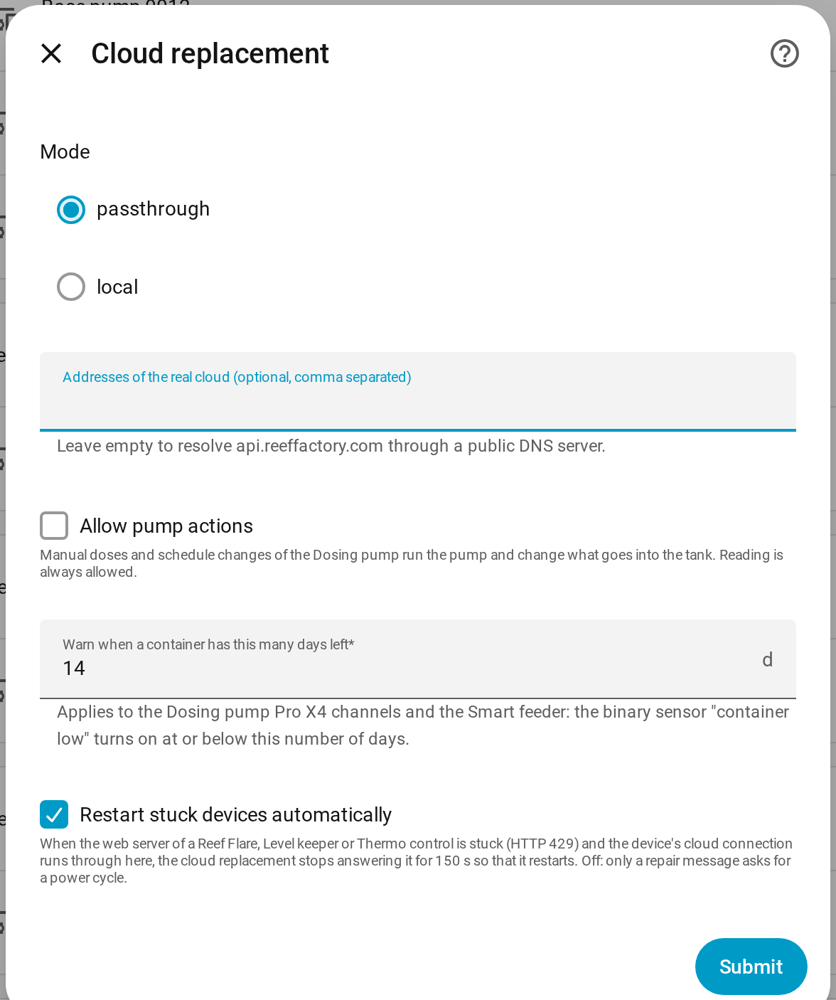

# Cloud replacement

[← Back to the README](../README.md)

The Smart feeder, the Base pump and the Dosing pump Pro X4 have no local interface at all: they only talk to
`api.reeffactory.com` (TLS on port 444, ESP8266 devices plain text on 442). They do **not** check the
server certificate, so Home Assistant can take the cloud's place. Add the integration a second time
and choose **Cloud replacement** - no IP, no serial number; every device that connects shows up by
itself with all its entities.

The Level keeper, Thermo control and Reef Flare connect to the cloud the same way. They are read and
controlled through their local port as before, but when their cloud connection also runs through the cloud
replacement, the integration can restart them when their web server is stuck
([Stuck web server (HTTP 429)](troubleshooting.md#stuck-web-server-http-429)).
The DNS entry below covers all devices at once.

**Recommended for all devices: let their cloud connection run through the cloud replacement**, also for
the devices with a local port. Then a stuck device is fixed without anyone having to pull a plug, and the
official app keeps working in passthrough mode.

## Two modes

- **Passthrough** (default): everything is forwarded to the real cloud and read along. The official
  app keeps working, Home Assistant can still send commands. When the real cloud cannot be reached,
  the device is served locally instead - automatically - and the cloud is tried again every two minutes.
- **Local**: Home Assistant answers alone; the app does not see the device any more.

## The one thing you have to do yourself: DNS

The devices must resolve `api.reeffactory.com` to the Home Assistant host **inside your network**.
Home Assistant cannot do that for you.

<b>How to set it, by DNS server</b>

- **AdGuard Home**: Filters → DNS rewrites → add `api.reeffactory.com` → `<HA IP>`.
- **Pi-hole**: Local DNS → DNS Records → `api.reeffactory.com` → `<HA IP>`.
- **FRITZ!Box** (in addition, if your devices use the box as DNS server): Home Network → Network →
  Network Settings → *DNS Rebind Protection* → add `api.reeffactory.com` as an exception. Without it
  the box swallows the answer and the devices get nothing.
- Routers that let you set a DNS override per host work the same way.

Then restart the devices once (power off/on) - they keep their old connection to the real cloud
otherwise. After that they follow Home Assistant on their own: a restart or reload drops them with a
TCP reset and they reconnect about 15 s later (checked with the Smart feeder, firmware 1.1.6).

<b>Ports, and what happens to the official app</b>

Home Assistant must be able to open ports 442, 444 and (for the app passthrough) 80, 443, 445 and 446. That is
the case on Home Assistant OS and in Docker with host networking. If a port is taken (a reverse proxy
on 80/443, say), the log says so; the devices still work, only the official app will not work from
inside your network.

Everyone in your network who looks up `api.reeffactory.com` now gets Home Assistant - including the
phone with the official app. Ports 80, 443, 445 and 446 are passed through untouched (end-to-end TLS with the real
cloud), so the app works at home as well; from outside your network nothing changes.

If you put a proxy in front of the ports: it must not send WebSocket close frames to the devices - see
[Known quirks](troubleshooting.md#known-quirks).

## Options

*Settings -> Devices & services -> Reef Factory Local -> cloud replacement entry -> Configure*:

| Option | What it does |
|---|---|
| *Mode* | passthrough or local, see above |
| *Addresses of the real cloud* | optional; leave empty to resolve `api.reeffactory.com` through a public DNS server |
| *Allow pump actions* | dose now and schedule changes of the Dosing pump Pro X4 - see [Pump actions](pump-actions.md) |
| *Warn when a container has this many days left* | threshold of the *container low* sensors (default 14) - see [Automations](automations.md#container-low) |
| *Restart stuck devices automatically* | on by default - see [Stuck web server](troubleshooting.md#stuck-web-server-http-429) |

## Security note

<b>What the devices send, and who may connect</b>

The devices send their account data to whatever answers as `api.reeffactory.com`: Smart feeder, Base pump
and Dosing pump Pro X4 a token and the e-mail, Level keeper, Thermo control and Reef Flare the e-mail and
the password in plain text. The cloud replacement never stores them and never logs them (the debug log
included, since 1.2.3), but anyone who controls your DNS could read them. That is a property of the
devices, not of this integration.

The other direction: the cloud replacement cannot check who connects. A device is whoever opens port 442
or 444 and sends a serial number - the integration does not know the devices' keys, so it cannot verify
them. **Keep these ports inside your network; never forward them from the internet.** Anyone who can
reach them can make a device with an invented serial number appear. What the integration does prevent: a
connection that claims the serial number of a device that is connected right now is refused when it comes
from another address (logged as a warning), so it can neither feed values into that device's entities nor
receive its commands. If a device really got a new address, it is accepted as soon as its old connection
has been silent for a minute.

Also without the cloud replacement: Level keeper, Thermo control and Reef Flare talk to the cloud
unencrypted (WebSocket on port 442) and send the Smart Reef login - e-mail and password - as plain text.
Smart feeder, Base pump and Dosing pump Pro X4 use TLS on port 444, but do not check the server's
certificate. Use a password for Smart Reef that you use nowhere else.

## Advanced: no DNS at all (firmware patch)

Only for people who are comfortable with soldering and esptool

The cloud host name is a plain string in the device firmware. With a serial adapter you can read the
flash, replace the name by the Home Assistant IP and write it back. There is no ready-made tool for that
here, and I have not done it on my own devices. Only for people who are comfortable with
soldering and esptool - a mistake can brick the device.

