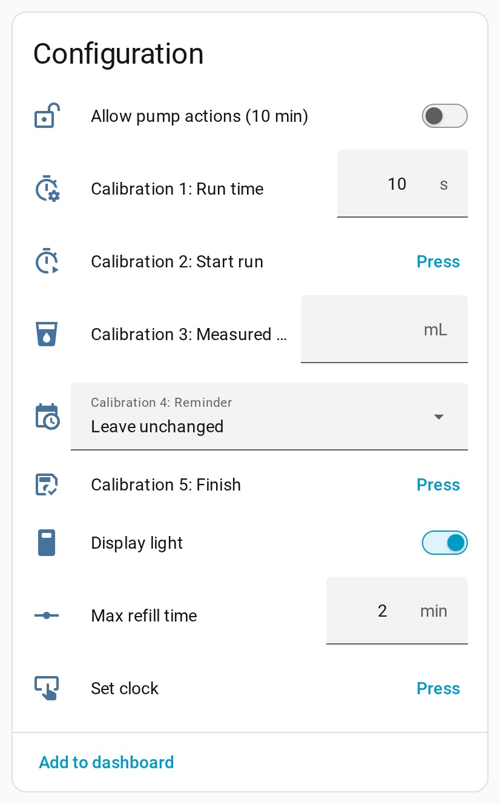

# Pump actions and guided calibration

[← Back to the README](../README.md)

## Pump actions are off by default

Level keeper: manual refill, calibration run and filling the hose run the refill pump. Dosing pump Pro X4:
dosing now and replacing a channel's schedule put additives into the tank. These are only available as
actions (plus the *Start run* button of the guided calibration) and only after enabling *Allow pump
actions*:

- for each **Level keeper** in its own entry's options,
- for the **Dosing pump Pro X4** in the options of the *cloud replacement* entry

(*Settings -> Devices & services -> Reef Factory Local -> Configure*). Stopping the Level keeper always
works (button *Stop pump action* or the stop actions). Factory reset is deliberately not offered.

## Unlock for ten minutes instead

Instead of leaving the option on, every Level keeper and the Dosing pump Pro X4 have a switch *Allow pump
actions (10 min)*: it unlocks the actions of that entry for ten minutes and then turns itself off (it is
not stored - after a restart it is off). A dashboard script can turn it on, call the action and turn it
off again. Nothing is sent to the device by the switch itself.

## Guided calibration (Level keeper)

The calibration is also available step by step on the Level keeper's device page, under *Configuration*.
The five entities carry their step number, so the device page lists them in the order they are used.

<b>The five steps</b>

1. *Calibration 1: Run time* - 10 s is fine.
2. *Calibration 2: Start run* - hold the hose into a measuring cup first. It runs the pump, so it needs
   *Allow pump actions* (the option in the entry's *Configure* dialog for good, or the 10-minute switch on
   the device page - see above). *Calibration run time left* counts down;
   *Stop pump action* stops the run.
3. *Calibration 3: Measured amount* - what the cup shows, in mL.
4. *Calibration 4: Reminder* - when the device should ask for the next calibration. *Leave unchanged* (the
   default) keeps the period the device has. The device offers 1 week to 3 months and no way to turn the
   reminder off.
5. *Calibration 5: Finish* - sends the amount (and the reminder period, if one is chosen).

Run time, amount and reminder are only kept in Home Assistant and are sent with the two buttons - the same
frames as the actions `calibration_start` and `calibration_value`. The measured amount is emptied by a new run
and after saving, and *Finish* refuses to send while it is empty or the run is still going.

Before you calibrate: hose, cup, pause

Calibration (tested 03.11.2026): put the refill hose into a measuring cup, *fill hose* until water comes,
stop, empty the cup, run the calibration (default 10 s, as on the device page), enter the measured mL.
Both work while refilling is paused - pause first so the device does not refill into the cup.

What <i>Next calibration</i> means

*Next calibration* is the date the device reminds you to calibrate again (calibration time + chosen
reminder period), not the date of the last calibration. Logging the device into a Smart Reef account
sets it to "today / not due" without any calibration. Without calibration the mL values are estimates.

