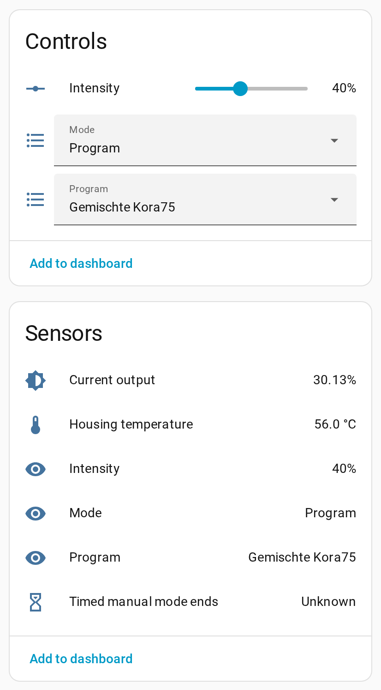

# Reef Flare programs and actions

[← Back to the README](../README.md)



## What a program is

A program is a list of 2 to 31 points `{time: "HH:MM", levels: [7 × 0–100]}`. The first point must be
`00:00`, the last `24:00`, times strictly increasing (the same rules as the device's web page).
The light fades linearly between points; *intensity* scales the whole program.

The 7 levels are, in this order (names from the device's own web page):
**UV, violet, indigo, blue, green, red, white**.

All Reef Flare actions take one or more lights - handy if two lights are programmed together (each light
must have a program of that name active when `program` is given, otherwise nothing is written).

## Actions

| Action | What it does |
|---|---|
| `flare_program_set` | write the active program |
| `flare_program_create` | new program in the first free slot |
| `flare_program_delete` | set a stored program back to the light's empty program |
| `flare_manual` | timed manual mode, with levels or a stored manual preset |
| `flare_preset_save` | save or overwrite a manual preset |
| `flare_preset_delete` | delete a manual preset |
| `flare_import` / `flare_export` | the app's export files |

Click an action for the details and an example.

<details>
<summary><b>Write the active program</b> - <code>flare_program_set</code></summary>

The current points are in the attributes of the *Program* sensor, so a program can be copied, changed and
written back:

```yaml
action: reef_factory_local.flare_program_set
data:
  device_id: <your Reef Flare>
  points:
    - {time: "00:00", levels: [0, 0, 0, 0, 0, 0, 0]}
    - {time: "11:00", levels: [100, 100, 100, 100, 50, 50, 80]}
    - {time: "20:00", levels: [60, 65, 65, 100, 40, 35, 10]}
    - {time: "24:00", levels: [0, 0, 0, 0, 0, 0, 0]}
```

The device only reports the points of the *active* program, so `flare_program_set` only writes the active
program. To change another one, select it first (*Program* select), then write it.

</details>

<details>
<summary><b>Create a program</b> - <code>flare_program_create</code></summary>

A new program goes into the first free slot (the light stores 8). Without `points` it is a copy of the
active program; the light stays on its current program unless `activate` is on:

```yaml
action: reef_factory_local.flare_program_create
data:
  device_id: [<Reef Flare 1>, <Reef Flare 2>]
  name: Summer
  activate: true
```

</details>

<details>
<summary><b>Delete a program</b> - <code>flare_program_delete</code></summary>

The app cannot really delete a program, only set it up again; `flare_program_delete` sets a stored program
(not the active one) back to what the light puts into a free slot - 08:00-20:00 at 40/35/30/25/20/15/10 %,
intensity 100 %, no name (the app lists it as empty). The light briefly selects it and goes back.

There is no action that renames an existing program: create a copy under the new name, then reset the old
one.

</details>

<details>
<summary><b>Timed manual mode</b> - <code>flare_manual</code></summary>

Timed manual mode (the app's *timer mode*): the light switches to manual mode with the given levels for the
active manual preset and goes back to its program by itself when the time is up (1 to 360 minutes). To end
it earlier, set the *Mode* select back to *Program*.

```yaml
action: reef_factory_local.flare_manual
data:
  device_id: [<Reef Flare 1>, <Reef Flare 2>]
  levels: [0, 30, 30, 40, 0, 0, 10]
  duration_min: 30
```

Run a stored manual preset instead (it becomes the active preset; its levels stay as they are):

```yaml
action: reef_factory_local.flare_manual
data:
  device_id: [<Reef Flare 1>, <Reef Flare 2>]
  preset: Moonlight
  duration_min: 60
```

The sensor *Timed manual mode ends* shows when the light goes back to its program.

</details>

<details>
<summary><b>Manual presets</b> - <code>flare_preset_save</code>, <code>flare_preset_delete</code></summary>

The light stores 8 manual presets - the *timed programs* of the app, with name, levels and intensity. They are
in the attribute `manual_presets` of the *Program* sensor. The light reports them only in manual mode, so the
last known list is kept over a restart; writing always reads it fresh.

Save one - without `preset` a new one goes into the first free slot, with `preset` that one is overwritten
(and renamed if `name` differs). The light goes to manual mode for a few seconds to report its list and then
back to its previous mode:

```yaml
action: reef_factory_local.flare_preset_save
data:
  device_id: [<Reef Flare 1>, <Reef Flare 2>]
  name: Moonlight
  levels: [0, 10, 10, 30, 0, 0, 0]
  intensity: 50
```

`flare_preset_delete` (with `preset`) deletes one the way the app does: the name is cleared and all
channels go to 10 %; the slot is free again.

There is no select or number entity for manual presets; they are handled with these actions.

</details>

<details>
<summary><b>Import and export of the app's files</b> - <code>flare_import</code>, <code>flare_export</code></summary>

The app can export a program or a timed program as a small JSON file. `flare_import` takes the content of
such a file (paste the text): a program file overwrites the active program (with `name` it becomes a new
program instead), a timed program file is saved as manual preset. `flare_export` returns the active program
(or, with `preset`, a manual preset) in the same format - the result can be imported in the app again.

```yaml
action: reef_factory_local.flare_import
data:
  device_id: [<Reef Flare 1>, <Reef Flare 2>]
  file: '{"n":"Grün","s":true,"l":[0.1,0.1,0.1,0.54,1,0.1,0.1],"intensity":63}'
```

</details>

## Good to know

- Reef Flare stores programs in its flash. Do not change intensity or programs every few minutes from
  an automation.
- Reef Flare writing uses exactly the frames of the device's own web page, checked byte for byte
  against what the device sends (see [Confirmed writes](confirmed-writes.md) for what is offered).
- `flare_program_create` and `flare_program_delete` select the other slot for a moment themselves.
- The program **preview** of the app is not offered: the light reports nothing back, so it could not be
  confirmed.
- Tested on two Reef Flare S. The M and L models hold two and three of the same light modules and use the
  same web interface, so the integration treats them the same way.
